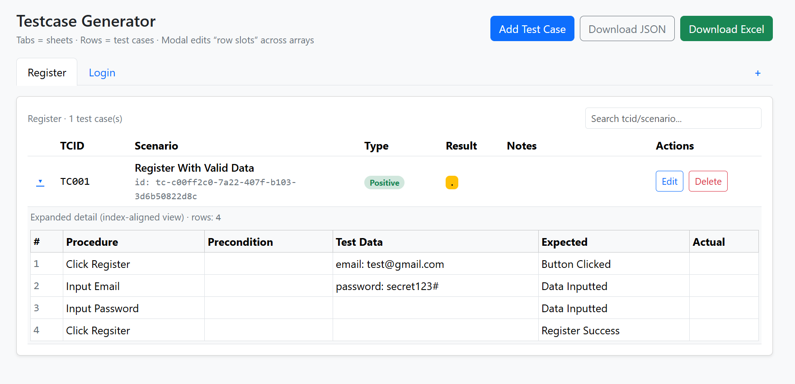
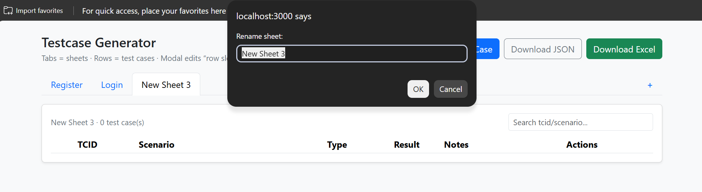
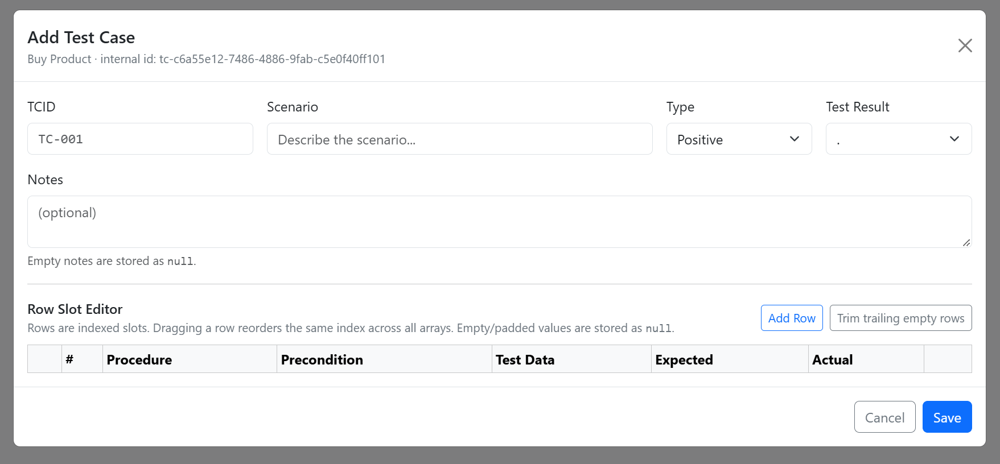

# QA Test Case Generator

A lightweight, web-based tool for creating, organizing, and exporting **manual QA test cases**. Build test cases in a simple browser interface, group them into sheets, and download a formatted **Excel (`.xlsx`) workbook** or a **JSON (`.json`) file**.

This project was **created spesifically for me** to make my everyday QA test-case documentation faster and more consistent, without manually formatting spreadsheets. So it may not fit your templating style, but it works for me



## Table of Contents# QA Test Case Generator

A lightweight, web-based tool for creating, organizing, and exporting **manual QA test cases**. Build test cases in a simple browser interface, group them into sheets, and download a formatted **Excel (`.xlsx`) workbook** or a **JSON (`.json`) file**.

This project was **created spesifically for me** to make my everyday QA test-case documentation faster and more consistent, without manually formatting spreadsheets. So it may not fit your templating style, but it works for me


## Table of Contents

- [Features](#features)
- [Tech Stack](#tech-stack)
- [Installation](#installation)
- [Usage](#usage)
- [Project Structure](#project-structure)
- [Test Case Format](#test-case-format)

## Features

- **Organize test cases by sheet:** Create multiple sheets to separate features or testing areas; double-click a sheet tab to rename it.
- **Manage test cases:** Add, edit, view, and delete individual test cases.
- **Document test details:** Record test case ID, scenario, type, execution result, notes, and step-by-step testing information.
- **Support common test types:** Positive, Negative, Edge, and Regression.
- **Track execution results:** Pass (`1`), Fail (`0`), Blocked, or `.` (an unset/placeholder result).
- **Edit step-by-step details:** Add, remove, and drag to reorder rows containing procedures, preconditions, test data, expected results, and actual results.
- **Search quickly:** Filter test cases in the active sheet by test case ID or scenario.
- **Export to Excel:** Download an `.xlsx` workbook with separate worksheets, formatted headers, cell borders, and merged test-case information.
- **Export to JSON:** Download your current test-case data in JSON format.

### TODO
- Enable browser-based persistence or add a database.
- Support importing JSON and Excel files for continued editing.
- Add stronger form and API validation, including unique TCID checks.

## Tech Stack
- HTML, CSS, Vanilla JavaScript
- Bootstrap for styling
- SortableJS for reordering test case detail rows
- NodeJS 
- Express
- EscelJS for creating and streaming ```.xlsx``` files


Bootstrap and SortableJS are loaded from CDNs by the frontend. No frontend build step is required.

## Installation

1. Clone the repository:

   ```bash
   git clone https://github.com/dikamahard/QA-testcase-generator.git
   ```

2. Open the backend directory:

   ```bash
   cd QA-testcase-generator/backend
   ```

3. Install the dependencies:

   ```bash
   npm install
   ```

4. Start the development server:

   ```bash
   npm run start-dev
   ```

5. Open **http://localhost:3000** in your browser.

The Express server also serves the frontend from `frontend/src/`, so you do **not** need to launch a separate frontend server.

> The server currently uses port **3000**, configured in `backend/app.js`.


## Usage

### 1. Create a sheet

Click the **`+`** button on the sheet-tab bar. Give each sheet a meaningful name, such as `Login`, `Registration`, or `Checkout`, by **double-clicking** its tab.



### 2. Add a test case

Select a sheet and click **Add Test Case**. Fill out the test-case details



### 3. Review and manage test cases

- Use the **expand arrow** to view all step-by-step details.
- Click **Edit** to modify a test case.
- Click **Delete** to remove a test case after confirmation.
- Use the **search box** to filter the current sheet by TCID or scenario.

### 4. Export your test cases

- **Download Excel:** Sends the current data to the backend and downloads `testcases.xlsx`. Each sheet in the editor becomes a worksheet in Excel.
- **Download JSON:** Downloads `testcases.json` with your data in a structured format.

**Important:** The application currently stores edits in browser memory only. Download your work **before refreshing or closing the page**. JSON export is available, but JSON import is not implemented in the current UI.


## Project Structure

```text
QA-testcase-generator/
├── backend/
│   ├── app.js                       # Express app and static frontend server
│   ├── package.json                 # Dependencies and npm scripts
│   ├── data2.js                     # Example test-case data
│   ├── controllers/
│   │   └── sheet-generator.js       # Excel worksheet layout and formatting
│   └── routes/
│       ├── index.js                 # Route exports
│       ├── excel.js                 # Excel export endpoint
│       └── test.js                  # Basic test endpoints
├── frontend/
│   └── src/
│       ├── index.html               # Bootstrap-based UI
│       └── app.js                   # Client-side state and editor behavior
├── .gitignore
└── README.md
```

## Test Case Format

The application represents a workbook as an **array of sheets**. Each sheet has a `sheetName` and a `testCase` array. Within a test case, each testing-detail field is an array, and values at the same index belong to the same detail row.

Example payload:

```json
[
  {
    "sheetName": "Login",
    "testCase": [
      {
        "tcid": "TC-001",
        "testscenario": "User can log in with valid credentials",
        "type": "Positive",
        "precondition": ["The user has an active account"],
        "testdata": ["Valid username and password"],
        "testprocedure": ["Open the login page", "Enter credentials and submit"],
        "expectedresult": [null, "The dashboard is displayed"],
        "actualresult": [null, null],
        "testresult": ".",
        "notes": null
      }
    ]
  }
]
```

Arrays can have different lengths; missing or empty detail cells can be represented by `null`. The browser UI also assigns internal `id` values to sheets and test cases for editing. The backend Excel exporter uses `sheetName` and `testCase` to build the workbook.


- [Features](#features)
- [Tech Stack](#tech-stack)
- [Installation](#installation)
- [Usage](#usage)
- [Project Structure](#project-structure)
- [Test Case Format](#test-case-format)

## Features

- **Organize test cases by sheet:** Create multiple sheets to separate features or testing areas; double-click a sheet tab to rename it.
- **Manage test cases:** Add, edit, view, and delete individual test cases.
- **Document test details:** Record test case ID, scenario, type, execution result, notes, and step-by-step testing information.
- **Support common test types:** Positive, Negative, Edge, and Regression.
- **Track execution results:** Pass (`1`), Fail (`0`), Blocked, or `.` (an unset/placeholder result).
- **Edit step-by-step details:** Add, remove, and drag to reorder rows containing procedures, preconditions, test data, expected results, and actual results.
- **Search quickly:** Filter test cases in the active sheet by test case ID or scenario.
- **Export to Excel:** Download an `.xlsx` workbook with separate worksheets, formatted headers, cell borders, and merged test-case information.
- **Export to JSON:** Download your current test-case data in JSON format.

### TODO
- Enable browser-based persistence or add a database.
- Support importing JSON and Excel files for continued editing.
- Add stronger form and API validation, including unique TCID checks.

## Tech Stack
- HTML, CSS, Vanilla JavaScript
- Bootstrap for styling
- SortableJS for reordering test case detail rows
- NodeJS 
- Express
- EscelJS for creating and streaming ```.xlsx``` files


Bootstrap and SortableJS are loaded from CDNs by the frontend. No frontend build step is required.

## Installation

1. Clone the repository:

   ```bash
   git clone https://github.com/dikamahard/QA-testcase-generator.git
   ```

2. Open the backend directory:

   ```bash
   cd QA-testcase-generator/backend
   ```

3. Install the dependencies:

   ```bash
   npm install
   ```

4. Start the development server:

   ```bash
   npm run start-dev
   ```

5. Open **http://localhost:3000** in your browser.

The Express server also serves the frontend from `frontend/src/`, so you do **not** need to launch a separate frontend server.

> The server currently uses port **3000**, configured in `backend/app.js`.


## Usage

### 1. Create a sheet

Click the **`+`** button on the sheet-tab bar. Give each sheet a meaningful name, such as `Login`, `Registration`, or `Checkout`, by **double-clicking** its tab.


### 2. Add a test case

Select a sheet and click **Add Test Case**. Fill out the test-case details


### 3. Review and manage test cases

- Use the **expand arrow** to view all step-by-step details.
- Click **Edit** to modify a test case.
- Click **Delete** to remove a test case after confirmation.
- Use the **search box** to filter the current sheet by TCID or scenario.

### 4. Export your test cases

- **Download Excel:** Sends the current data to the backend and downloads `testcases.xlsx`. Each sheet in the editor becomes a worksheet in Excel.
- **Download JSON:** Downloads `testcases.json` with your data in a structured format.

**Important:** The application currently stores edits in browser memory only. Download your work **before refreshing or closing the page**. JSON export is available, but JSON import is not implemented in the current UI.


## Project Structure

```text
QA-testcase-generator/
├── backend/
│   ├── app.js                       # Express app and static frontend server
│   ├── package.json                 # Dependencies and npm scripts
│   ├── data2.js                     # Example test-case data
│   ├── controllers/
│   │   └── sheet-generator.js       # Excel worksheet layout and formatting
│   └── routes/
│       ├── index.js                 # Route exports
│       ├── excel.js                 # Excel export endpoint
│       └── test.js                  # Basic test endpoints
├── frontend/
│   └── src/
│       ├── index.html               # Bootstrap-based UI
│       └── app.js                   # Client-side state and editor behavior
├── .gitignore
└── README.md
```

## Test Case Format

The application represents a workbook as an **array of sheets**. Each sheet has a `sheetName` and a `testCase` array. Within a test case, each testing-detail field is an array, and values at the same index belong to the same detail row.

Example payload:

```json
[
  {
    "sheetName": "Login",
    "testCase": [
      {
        "tcid": "TC-001",
        "testscenario": "User can log in with valid credentials",
        "type": "Positive",
        "precondition": ["The user has an active account"],
        "testdata": ["Valid username and password"],
        "testprocedure": ["Open the login page", "Enter credentials and submit"],
        "expectedresult": [null, "The dashboard is displayed"],
        "actualresult": [null, null],
        "testresult": ".",
        "notes": null
      }
    ]
  }
]
```

Arrays can have different lengths; missing or empty detail cells can be represented by `null`. The browser UI also assigns internal `id` values to sheets and test cases for editing. The backend Excel exporter uses `sheetName` and `testCase` to build the workbook.

